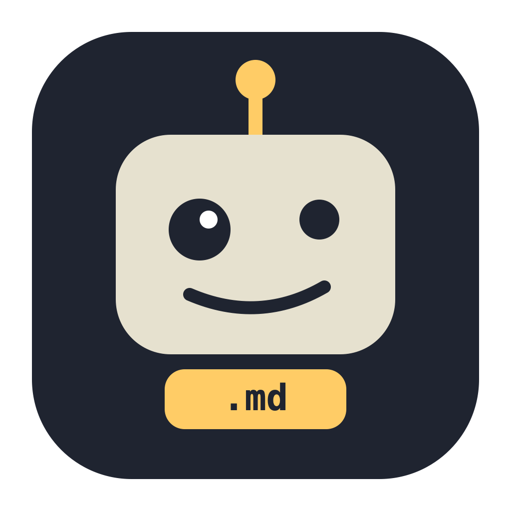

<p align="center">
  
</p>

<h1 align="center">dumBot</h1>

A native desktop app for running your own bots, like a local Grok bot, powered by
[opencode](https://opencode.ai) and a folder of markdown files. Built with
[Rune](https://github.com/anomalyco/rune) (through [a fork](https://github.com/vangheem/rune)),
like [gitsnack](https://github.com/vangheem/gitsnack).

A bot is a folder of markdown. You give it a name and a purpose. It writes its own
instructions, keeps notes, does the job (on your computer, or in your browser through the
browse MCP), and decides when it should run next. The next run starts from whatever it wrote
down.

## How bots work

Each bot lives in `~/.local/share/dumbot/bots/<slug>/`:

- `AGENTS.md`: who the bot is and how it works. Runs use the bot's folder as their working
  directory, so opencode loads it into every session. The bot rewrites it as it learns.
- `memory/*.md`: everything else it keeps (notes, logs, to-dos, things already handled).
- `bot.json`: dumBot's record of the bot's model, schedule and runs.
- `.opencode/`: what dumBot writes before every run (from `src/prompts/`):
  - `agents/dumbot.md`: the agent every run uses. Its system prompt is the bot's operating
    loop: journal and update memory after each step, edit `AGENTS.md` the moment it learns
    something, fan independent work out to several subagents at once, review itself, then
    schedule the next run. It may edit its folder and run `dumbot wake` without asking.
  - `agents/dumbot-worker.md`: a subagent for parallel tasks, which writes its results under
    `memory/work/`.
  - `skills/dumbot-evolve/SKILL.md`: how to restructure `AGENTS.md` and write its own skills
    and subagents.

  The bot's own skills and subagents live beside them, and show up in the app.

The folder is a git repository, because opencode only loads a folder's `AGENTS.md` and
`.opencode/` agents in a project.

Every run is a new opencode session. Its first prompt says why the bot woke up and passes on
any note its last run left. Bots schedule themselves with:

```sh
dumbot wake <bot> in 30m                     # one-off: in 2h, in 1d, at 09:00, at 2026-12-01 09:00
dumbot wake <bot> every 6h --note "check the PR queue first"
dumbot wake <bot> on wed,thu at 19:00        # weekly rules add up: mon..sun, weekdays,
dumbot wake <bot> on sat,sun at 10:00,18:00  #   weekends, daily; several times per rule
dumbot wake <bot> off                        # clears everything
dumbot list                                  # every wake-up and its note
dumbot list
dumbot run <bot> [message]                   # start a run now, from a script or cron
```

A bot wakes at the earliest of its one-off, interval and weekly times. A `--note` belongs to
the rule or wake-up it was given with, and the run that wakes gets the notes of what fired. `dumbot wake` writes
`bot.json`; the running app re-reads bots every few seconds and starts the ones that are due.
A bot whose last run is still working (or waiting on its subagents) waits for it to finish.
Bots only wake while the app is running; times missed while it was closed run once when it
next starts.

## Instructions, environment variables and scripts

- **Instructions for all bots** (sidebar) is markdown added to every bot's system prompt, and
  its subagents'. Use it for what every bot should know: "I have Gotify at …; the token is in
  `$GOTIFY_TOKEN`", your time zone, house rules. It's kept in
  `~/.local/share/dumbot/instructions.md`.
- **Environment variables**, global (sidebar) or per bot (**Environment…**), are for secrets
  and settings. They live in `~/.local/share/dumbot/env.json` (owner-only), outside every
  bot's folder. Each bot folder's opencode config sets its `shell` to a dumBot wrapper
  (`~/.local/share/dumbot/shell/<slug>`, running `dumbot shell <slug>`), so every shell
  command the bot or its subagents run gets them. Bots are told only the names. The wrapper
  replaces any value in command output with `[$NAME]`, and permission rules block reading
  `env.json` and dumping the environment. A bot could still put a value somewhere outside
  command output (say, write it into a file and open that with the read tool); its
  instructions forbid that, but it isn't enforced.
- **Scripts**: bots keep reusable scripts in `scripts/`, which they can run without asking.
  Scripts get the environment variables and show up in the app.

## Features

- A list of bots with their next wake-up or running status. **New bot** (⌘N) creates one and
  starts its first run, where it works out how to do its job and picks a schedule.
- The bot's markdown files, rendered, refreshed as runs change them.
- Each run's model, token usage and cost, and its transcript: tool calls, permission requests to allow or reject, a composer to
  message the run, **Stop**, and **Open in terminal** (attaches the opencode TUI).
- A **Schedule** tab listing each wake-up (a one-off, an interval, each weekly rule) with its
  next time and note, to remove any of them or add one: once on a day and time, weekly on
  chosen days, or repeating every so many minutes, hours or days.
- **Run now** (with the composer text as a message, if any), and **Open folder** to edit
  files yourself.
- A default model (bottom of the sidebar) and a model per bot. Changing either also switches
  the bot's latest run, so a run that's working or that you message next uses it.

## Browser automation with browse

Most useful bots work on websites: your email, a fantasy league, a store, an admin
dashboard. Many of those sites have no API, or need you logged in.
[**Browse**](https://opencode.ai/product/browse) from opencode is what makes those bots
possible. It's an MCP server and a Chromium extension that let agents use your real browser
(Chrome, Edge, Brave, Arc and others), with your tabs, logins and extensions. Agents open tabs
in the background, in collapsed groups out of your way, and read pages, click, type and take
screenshots. When it's your turn (a login, 2FA or a payment), they hand the tab back to you
and continue once you click Continue.

dumBot builds on it:

- Every bot's instructions tell it to use the browse tools for anything on a website, and to
  write down what it learns about a site (URLs, page layout, what to click) in its
  `AGENTS.md`, so later runs go straight to the right page.
- Subagents each open their own tabs, so a bot can research several pages at once.
- Bots can turn browser routines into skills and scripts that later runs reuse.

To set it up, install the
[browse extension](https://chromewebstore.google.com/detail/mfnicocicmmlkpjnaffgihfjhdgjkdjg)
from the Chrome Web Store; it walks you through the rest, including adding browse to opencode.
See [opencode.ai/product/browse](https://opencode.ai/product/browse) for details and
[github.com/anomalyco/browse](https://github.com/anomalyco/browse) for the source. Bots
without browse still work, but only with what the shell and simple web fetches can reach.

## Requirements

- [`opencode`](https://opencode.ai) v2. dumBot uses opencode's shared background service
  (the one the TUI uses) and starts it when it isn't running.
- Strongly recommended: [Browse](https://opencode.ai/product/browse) from opencode, so bots can use your browser ([how dumBot uses it](#browser-automation-with-browse)).

## Install

```sh
brew install vangheem/tap/dumbot
dumbot install-app        # optional: ~/Applications/dumbot.app (macOS)
```

Prebuilt binaries are on the [releases page](https://github.com/vangheem/dumbot/releases),
and `make install` builds from source into `~/.local/bin`. dumBot checks for new releases
and offers **Update and restart** for Homebrew installs.

## Releasing

Run the **Release new version** workflow (`gh workflow run bump-version.yml -f bump=patch`).
It bumps the version, tags `vX.Y.Z`, and the release workflow builds macOS and Linux
binaries, publishes the GitHub release, and updates the formula in
[vangheem/homebrew-tap](https://github.com/vangheem/homebrew-tap). Every push to `main` also
refreshes a rolling `latest` prerelease. It needs the `RELEASE_DEPLOY_KEY` and
`HOMEBREW_TAP_DEPLOY_KEY` secrets, as gitsnack does.

## Development

```sh
make run
make test
make lint
cargo test -- --ignored        # also hits the local opencode service and GitHub
cargo run -- --snap out.png --scene demo --size 1440x900 --theme dark
```

- `src/main.rs`: app state, the scheduler loop and all views.
- `src/bots.rs`: bot folders, `bot.json`, the `dumbot` agent and starting runs.
- `src/schedule.rs`: parsing and describing wake-up times.
- `src/cli.rs`: `dumbot wake`, `run` and `list`.
- `src/opencode.rs`: client for opencode's local HTTP API.
- `src/store.rs`: app settings (`~/.local/share/dumbot/state.json`).
- `src/update.rs`, `src/appbundle.rs`: self-update and the macOS app bundle.

## License

MIT
